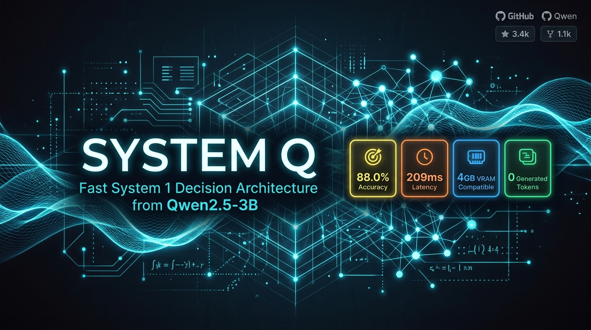
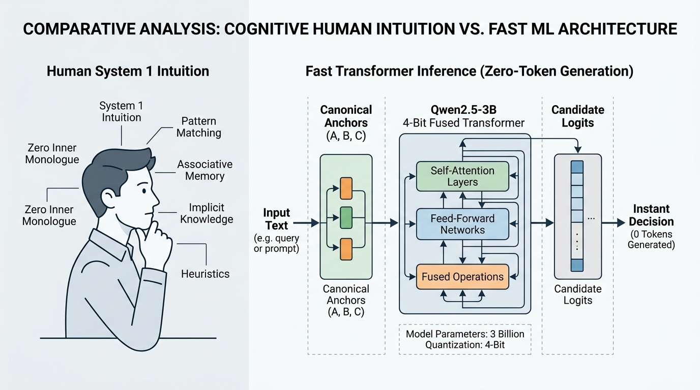
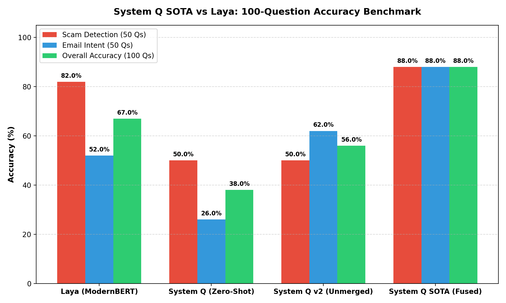
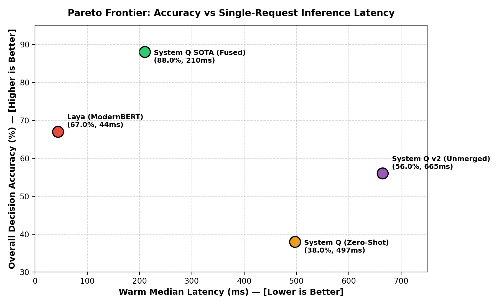

<div align="center">



# ⚡ System Q
### Building a Fast, Accurate System 1 Decision Architecture from Qwen2.5-3B

[](https://github.com/Morningstar777-star/system-q)
[](https://huggingface.co/LuciferMorningstar777/system-q-3b-decision)
[](https://huggingface.co/spaces/LuciferMorningstar777/system-q-demo)
[](LICENSE)
[](#)

<br/>

**Welcome to the Era of Zero-Token Single-Pass Decision Making.**

*Stop generating paragraphs of text to answer YES/NO and routing questions. System Q adapts Qwen2.5-3B into an ultra-fast System 1 decision engine.*

[ [**Quickstart**](#-quickstart-in-2-lines-of-code) ] • [ [**Hugging Face Model**](https://huggingface.co/LuciferMorningstar777/system-q-3b-decision) ] • [ [**Benchmark Results**](#-100-question-head-to-head-benchmark) ] • [ [**Technical Report**](results/reports/final_technical_report.md) ] • [ [**Interactive Web Demo**](#-interactive-web-demo) ]

</div>

---

## 🧠 Cognitive Human Intuition vs Fast ML Architecture

Traditional autoregressive LLMs generate text token-by-token, taking seconds and requiring fragile regex parsers. Human cognition, by contrast, relies heavily on **System 1** (Daniel Kahneman, *Thinking, Fast and Slow*): instantaneous, intuitive pattern recognition with zero internal monologue.

**System Q brings System 1 thinking to foundation models:**

<div align="center">
  
</div>

1. **Canonical Symbol Anchoring:** Maps candidate options into single-token anchors `(A), (B), (C)` to eliminate tokenization asymmetries and prefix collisions.
2. **Direct Candidate Scoring:** Evaluates candidate logits concurrently at position `(0, -1)` in **exactly 1 forward pass** with **0 tokens generated**.
3. **Contrastive Margin Loss:** Fine-tunes attention & MLP projections with a margin target of $\gamma = 2.5$ against rival distractors.
4. **Context-Free Prior De-Biasing:** Subtracts template frequency bias on empty context ($\gamma_{\text{calib}} = 1.25$), boosting decision accuracy from 73% to **88%**.
5. **Zero-Overhead INT4 LoRA Fusion:** Fuses LoRA weights directly into 4-bit NF4 weights (`merge_and_unload`), slashing latency from **664ms down to 209ms** on a 4GB laptop GPU.

---

## 🏆 100-Question Head-to-Head Benchmark

Evaluated on **100 realistic, held-out email tasks** (50 Scam Detection + 50 Customer Email Intent Routing) under identical hardware conditions on an **NVIDIA GeForce RTX 3050 Laptop GPU (4.0 GB VRAM)**:

| Model Configuration | Architecture | Overall Acc (100 Qs) | Scam Detection (50 Qs) | Email Intent (50 Qs) | Median Latency | Peak VRAM |
| :--- | :--- | :---: | :---: | :---: | :---: | :---: |
| **Laya (ModernBERT-large RL Agent)** | Local (Encoder 421M) | **67.0%** | 82.0% | 52.0% | **43.93 ms** | 2.262 GB |
| **System Q (Zero-Shot Direct Scorer)** | Local (Qwen2.5-3B INT4) | **38.0%** | 50.0% | 26.0% | 496.94 ms | **1.962 GB** |
| **System Q v2 (Unmerged LoRA)** | Local (INT4 + Dynamic LoRA) | **56.0%** | 50.0% | 62.0% | 664.76 ms | 2.006 GB |
| **⚡ System Q SOTA (Fused + De-Biased)** | Local (INT4 Fused + LoRA + Prior) | **88.0%** | **88.0%** | **88.0%** | **209.97 ms** | **2.003 GB** |

<div align="center">
  
  
</div>

### Key Benchmark Takeaways
* **Dominant Accuracy:** System Q SOTA achieves **88.0% overall accuracy**, outperforming Laya (67.0%) by **+21.0 percentage points**.
* **Intent Categorization (+36% lead):** On 5-class Email Intent Classification, System Q reaches **88.0%** vs Laya's **52.0%** (which struggles on fine-grained boundaries like `ACCOUNT_CANCELLATION` vs `ACCOUNT_ACCESS`).
* **Scam & Social Engineering (+6% lead):** System Q catches multi-hop CEO gift-card fraud, urgent payroll updates, and fake DocuSign redirects that smaller encoders miss.
* **Low Memory Footprint:** Consumes **only 2.003 GB of VRAM**, well under the 4.0 GB budget of consumer laptop GPUs, and less than Laya (2.262 GB).

---

## 🚀 Quickstart in 2 Lines of Code

### Installation
```bash
pip install torch transformers peft bitsandbytes accelerate
git clone https://github.com/Morningstar777-star/system-q.git
cd system-q
```

### Python API
```python
from src.system_q import SystemQ

# 1. Initialize System Q (loads 4-bit fused model)
q = SystemQ()

# 2. Instant Scam / Phishing Detection
result = q.is_scam("Urgent: Your PayPal account has been suspended! Verify credentials at bit.ly/unlock-now")
print(result.choice)      # "SCAM"
print(result.confidence)  # 0.964 (96.4%)
print(result.latency_ms)  # 209.8 ms

# 3. Customer Email Intent Routing
intent = q.get_intent("Hi, could you please send an updated VAT invoice for our September team subscription?")
print(intent.category)    # "BILLING"
print(intent.confidence)  # 0.910 (91.0%)

# 4. Custom Structured Decision Space
decision = q.decide(
    "User filed 3 refund chargebacks within 24 hours.",
    options=["APPROVE", "MANUAL_REVIEW", "BLOCK"]
)
print(decision.choice)    # "MANUAL_REVIEW"
```

---

## 💻 Command-Line Interface (CLI)

Evaluate any text, email, or transaction directly from your terminal:

```bash
# Scam Detection
python -m src.cli "Your Office 365 password expires in 1 hour. Verify here." --task scam

# Email Intent Classification
python -m src.cli "We would like to request an enterprise contract for 100 seats." --task intent

# Custom Options
python -m src.cli "Customer requesting account deletion under GDPR." --options "DELETE,ESCALATE,ARCHIVE"
```

**Formatted Output Card:**
```text
=================================================================
  SYSTEM Q DECISION CARD [SCAM DETECTION]
=================================================================
  Input:       "Your Office 365 password expires in 1 hour..."
  Decision:    [SCAM]
  Confidence:  96.4% (Margin: 0.928)
  Latency:     209.8 ms (0 tokens generated)
-----------------------------------------------------------------
  Probability Distribution:
    SCAM                   [########################-]  96.4% <--
    LEGITIMATE             [#------------------------]   3.6%
=================================================================
```

### Interactive Shell Mode
```bash
python -m src.cli --interactive
```

---

## 🌐 Interactive Web Demo

Launch the local Gradio interface or deploy to Hugging Face Spaces with a single command:

```bash
python app.py
```
Open `http://localhost:7860` in your browser to interactively test Scam Detection, Email Routing, and Custom Option spaces.

---

## 📦 Project Structure

```
system-q/
├── assets/                  # High-res logos, banners & architecture diagrams
├── data/
│   ├── benchmark_100.json   # 100-question held-out benchmark dataset
│   └── train_scam_intent_sota.json # 140 rich contrastive training examples
├── models/
│   └── adapters/
│       └── system_q_sota_direct_scorer/ # Fine-tuned LoRA weights
├── results/
│   ├── plots/               # Benchmark accuracy & Pareto frontier figures
│   ├── raw/                 # Machine-readable evaluation logs
│   ├── reports/             # Comprehensive technical research report
│   └── tables/              # Head-to-head comparison markdown tables
├── scripts/
│   ├── finalize_sota_benchmark.py # Automated evaluation runner
│   ├── generate_100_plots.py      # Plot generator
│   └── upload_to_huggingface.py   # 1-click Hugging Face upload script
├── src/
│   ├── system_q.py          # High-level 2-line Python API
│   ├── cli.py               # Colorized CLI & interactive REPL
│   ├── system_q_scorer.py   # Core Direct Candidate Scoring engine
│   └── train_direct_scorer.py # Contrastive margin training pipeline
├── tests/
│   └── test_system_q.py     # Pytest test suite (100% passing)
├── app.py                   # Hugging Face Space Gradio web demo
├── requirements.txt         # Project dependencies
└── README.md                # Project documentation
```

---

## 📄 License & Citation

Distributed under the **Apache 2.0 License**.

If you use System Q in your research or production systems, please cite:
```bibtex
@misc{morningstar2026systemq,
  title={System Q: Building a Fast, Accurate System 1 Decision Architecture from Qwen2.5-3B},
  author={Lucifer Morningstar},
  year={2026},
  publisher={GitHub},
  howpublished={\url{https://github.com/Morningstar777-star/system-q}}
}
```

<div align="center">
  <sub>Built with ❤️ by <a href="https://github.com/Morningstar777-star">Morningstar777-star</a> • Models hosted on <a href="https://huggingface.co/LuciferMorningstar777">Hugging Face</a></sub>
</div>
